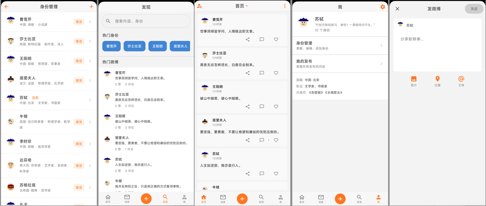

# PocketWeibo

A Weibo-like local notes app built with Jetpack Compose, Kotlin, and Room database.

## Features

### Core Features

- **Multi-Identity System**: Create and manage multiple identities (historical figures) and post content as different personas
- **Post Management**: Create, view, like, comment, and share posts
- **Comment System**: Add comments to posts with identity selection
- **Identity Details**: Each identity includes nationality, gender, birth/death years, occupation, motto, famous works, and bio
- **Cartoon Avatars**: 8 different cartoon avatar styles for identities
- **Swipe-Back Navigation**: Android-style swipe-back gesture support

### Screens

1. **Home**: Main feed showing all posts in a scrollable list
2. **Message**: View received and sent comments/notifications
3. **Discover**: Search for identities and posts, trending content
4. **Me**: View current identity, manage identities, see personal posts
5. **Compose**: Create new posts with identity selection
6. **Post Detail**: Full post view with comments
7. **Identity List**: Manage all identities (CRUD)
8. **Identity Detail**: View/edit individual identity details

### UI Design

- Twitter-like card design with rounded corners and subtle shadows
- Weibo orange (#FD8225) accent color
- Bottom 5-tab navigation
- Real-time like and comment counts
- Relative timestamps with milliseconds precision

## Screenshots

[](docs/screenshots/home_screen.png)

## TODO

### Home Screen
- [x] Improve action button alignment and spacing
- [x] Add visual feedback on button press

### Post Card
- [x] Card design with elevation and rounded corners
- [x] Avatar display with cartoon images
- [x] Action buttons (share, comment, like) on right side
- [x] Share button functionality
- [x] Better liked/unliked visual indicator
- [x] Reduce avatar image background (currently has yellowish tint)

### Post Detail Screen
- [x] Post content fully visible when typing comment
- [x] Comment input with keyboard handling
- [ ] Comment functionality improvement
- [ ] Reply to specific comments
- [x] Delete own comments (UI placeholder)

### Compose Screen
- [x] Image attachment support
- [x] Post preview before publishing
- [x] Draft saving
- [x] Character count limit

### Identity Management
- [x] Identity list with CRUD operations
- [x] Identity detail screen
- [x] Edit identity photo/avatar
- [x] Identity switch animation
- [x] Quick identity switch from home screen

### Discover Screen
- [x] Trending posts section
- [x] Search by identity name or post content
- [x] Filter by date range
- [x] Filter by identity
- [x] Trending topics/tags

### Message Screen
- [x] Received comments view
- [x] Sent comments view
- [ ] Push notification support (needs Firebase)
- [x] Unread message indicator

### General
- [x] Dark mode support
- [x] Data export/backup (JSON format)
- [x] Data import/restore
- [ ] App icon customization (needs separate app icon resources)

### Avatar Management
- [x] Upload custom avatar from gallery (database layer ready)
- [x] Take photo with camera for avatar (database layer ready)
- [x] Crop/resize avatar image
- [x] Avatar compression and optimization
- [x] Avatar preview before saving
- [x] Remove/reset avatar to default (database layer ready)

### Comments
- [x] Delete own comments
- [x] Edit own comments
- [x] Long press to copy comment
- [x] Comment reactions/likes
- [x] Sort comments (newest/oldest)

### Data Management
- [x] Export all data (posts, comments, identities) to JSON
- [x] Export data to CSV format
- [x] Import data from JSON backup
- [x] Selective data export (posts only, identities only, etc.)
- [x] Data migration between app versions
- [x] Clear all data option

## Tech Stack

- **Language**: Kotlin
- **UI Framework**: Jetpack Compose
- **Database**: Room
- **Architecture**: MVVM
- **Build System**: Gradle with KSP

## Database Schema

### IdentityEntity
- id (Primary Key)
- name
- avatarResName
- nationality
- gender
- birthYear / deathYear
- occupation
- motto
- famousWork
- bio
- isActive

### PostEntity
- id (Primary Key)
- identityId (Foreign Key)
- content
- imageUris
- createdAt
- likeCount
- commentCount
- isLiked

### CommentEntity
- id (Primary Key)
- postId (Foreign Key)
- identityId (Foreign Key)
- content
- createdAt

## Getting Started

1. Clone the repository
2. Open in Android Studio
3. Sync Gradle
4. Run on device/emulator

## macOS Development Environment

This repo was originally developed on a phone under Termux (Ubuntu); it now builds on macOS:

- **Android SDK**: `~/Library/Android/sdk` (set in `local.properties`, gitignored).
- **JDK**: none needed in PATH — Gradle falls back to Android Studio's bundled JetBrains Runtime
  (`/Applications/Android Studio.app/Contents/jbr/Contents/Home`, JDK 21). Install Android Studio,
  or set `JAVA_HOME` yourself if you use a standalone JDK.
- **adb**: available in PATH or at `~/Library/Android/sdk/platform-tools/adb`.
- **Release signing**: unchanged — `scripts/build-pocketweibo-release.sh` reads the same
  `secrets/github-keystore-secrets.local.txt` + keystore base64 (keystores carried over from the
  old machine). The release script is bash 3.2 compatible (macOS system bash).
- **Repository layout**: working docs (rules, ledgers, reviews) live in `docs/`; all local signing
  material (keystores, passwords, base64) lives in `secrets/` (gitignored; templates + README there).

## Wireless Debug Deploy

One-time pairing (on the phone: Settings → Developer options → **Wireless debugging** → ON,
then tap **Pair device with pairing code**):

```bash
./scripts/adb-wireless.sh pair <phone-ip:pair-port> <6-digit-code>
./scripts/adb-wireless.sh connect <phone-ip>   # port is auto-scanned (30000–50000)
```

Android 11+ picks a **dynamic port** for wireless debugging (usually 30000–50000). The script
finds it by mDNS when available, otherwise by a fast parallel port scan (`python3` asyncio, ~2 s;
`nc` fallback), so a fixed `:5555` is not required. The working `ip:port` is cached in
`~/.cache/pocketweibo-adb` (local only — no address is stored in the repo).

Every session afterwards (no address needed — auto-discovered / cached):

```bash
./scripts/adb-wireless.sh connect
```

Build + install over Wi-Fi after a new feature:

```bash
./scripts/adb-wireless.sh install-debug     # debug build, installed directly on the phone
./scripts/adb-wireless.sh install-release   # signed release build, installed on the phone
```

> Use `install-release` if the phone already has a release-signed build: Android refuses to
> upgrade across different signatures (`INSTALL_FAILED_UPDATE_INCOMPATIBLE`).

Extras:

```bash
./scripts/adb-wireless.sh status            # devices, mDNS services, cached address
./scripts/adb-wireless.sh logcat            # follow full logcat
./scripts/adb-wireless.sh crash             # follow fatal-exception (crash) log only
./scripts/adb-wireless.sh disconnect        # drop the Wi-Fi connection
./scripts/adb-wireless.sh enable-tcpip      # USB-plugged phone → legacy fixed :5555 mode
```

Overrides via env: `DEVICE_IP` (optional phone address; unset = auto-discover), `DEVICE_PORT`
(legacy `:5555` port, default 5555), `PORT_SCAN_START` / `PORT_SCAN_END` (default 30000 / 50000),
`PORT_SCAN_JOBS` (nc fallback parallelism).
