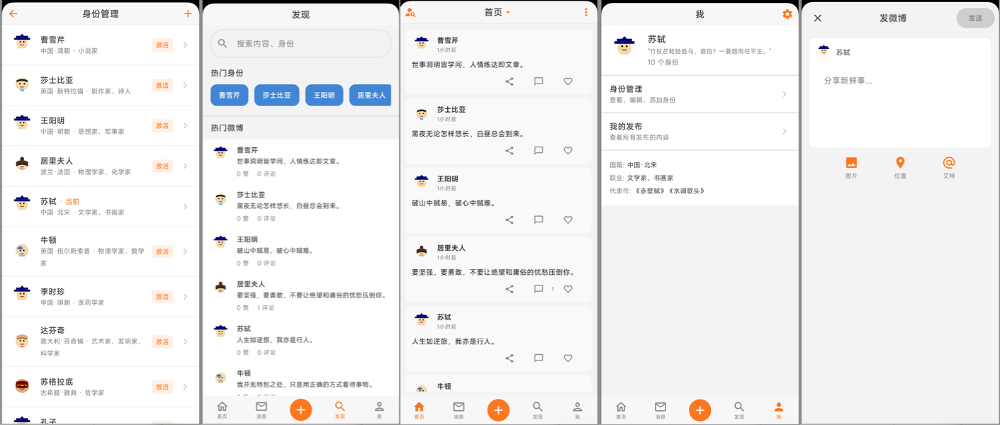

# PocketWeibo

[English](README.md) | **简体中文**

一款本地优先（local-first）的 Android 微博风格笔记应用。你可以用不同历史人物的身份写短微博、添加配图、发表文字或语音评论、设置系统提醒，并完全离线浏览所有内容。

所有数据都保存在设备上：**没有账号、没有后端、没有网络 API**。应用支持中英双语（默认简体中文，可在设置中切换 English），并支持浅色/深色主题。

## 功能亮点

### 身份

- 支持多个身份（历史人物），每个身份包含姓名、国籍/地区、性别、生卒年份、职业、名言、代表作和简介。
- 同一时间只有一个**当前身份**；可通过身份列表（设置 → 身份管理）、首页筛选面板选择身份，或使用定时规则自动切换。
- 内置 8 款手绘预设头像（Open Peeps，男 4 款 + 女 4 款），也可从相册选择自定义头像；移除自定义头像后会恢复预设头像。
- **身份定时切换**：添加规则（身份 + 时间 + 可选重复日），由 `AlarmManager` 自动切换当前身份（每天 / 工作日 / 周末 / 自定义星期）。
- 删除身份后，其微博和评论仍会保留，作者显示为**已注销账号**；如果删除的是当前身份，最早创建的其他身份会自动成为当前身份。

### 微博

- 微博正文最多 **2,000 字符**；草稿文本会在发微博页面之间保存并恢复。
- 每条微博最多 **9 张图片**，可从相册选择或拍照。超过约 1.5 MB 的图片会重新编码为高质量 JPEG（最长边 2560 px，质量 92）；GIF 和较小的文件保持原样。添加图片后可开启本条微博的**原图/不压缩**开关。
- 发送前会在后台处理图片；处理或发送过程中会阻止重复发送。
- 可在详情页菜单中**置顶微博**；置顶微博会排在信息流顶部。
- 长按微博可选择并复制正文。相对时间（如「3 小时前」）可点击切换为完整日期时间（含星期）。
- 列表卡片使用紧凑的**附图**角标代替缩略图；完整图库请在详情页查看。

### 评论

- 支持文字评论和**语音评论**（可只发语音，也可文字 + 语音）。
- 评论按**最新在前**排列，发送后列表会自动滚动到最新评论。
- 长按评论可复制正文；详情页支持将全部评论复制为编号纯文本（按时间从早到晚，不含作者和时间）。
- 可在发布后 **48 小时**内删除自己的评论（首页评论面板）；超过时间后不再显示删除入口。
- 评论语音可在列表中直接播放；录音横幅可点击结束录音并立即发送。
- 发现页会返回匹配的评论；首页搜索会展示评论匹配的微博。

### 提醒

- 可从微博详情菜单、列表卡片上的时钟按钮，或发微博页的提醒工具为任意微博添加**系统闹钟提醒**（在发微博页选好时间后会立即发布）。
- 快捷时间：15/30 分钟、1/3/6/10 小时、今天 20:00、明天 9:00（最常用的三个会排在前面），另有自定义日期时间选择器。
- 重复规则：一次、每天、工作日、每周、每月。
- 使用 `AlarmManager.setAlarmClock` 和通知；重启或应用更新后会恢复提醒，过期提醒会在下次启动时补发。
- **摇一摇设提醒**：在微博详情页摇一摇，可为当前微博安排提醒。设置中可调整晚间时间（默认 20:00）和次日早晨的备用时间（默认 09:00）。
- **待处理提醒**会显示在「我」页面，支持倒计时刷新、取消和打开微博。列表卡片显示橙色提醒徽标，详情页显示下次提醒时间和重复规则。
- 可选**系统日历同步**：将提醒同步到设备日历（重复提醒会写入 `RRULE`），即使 PocketWeibo 未运行，系统日历也能提醒。

### 首页、图片、发现、我

- **首页**：按时间倒序的信息流（置顶优先），带下拉刷新动效、搜索对话框和按身份筛选的标题面板。双击「首页」Tab 会滚动到最新微博并清除筛选。
- **图片**：只展示带配图微博的图片流。图片按真实宽高比显示，支持双指缩放（1×–4×）、拖动，以及以触点为约 2× 的双击缩放；点击图片可切换作者/时间/正文叠层。
- **发现**：热门身份和热门微博，以及跨身份、微博正文/作者和评论的搜索（结果可打开所属微博）。多个关键词可用 `|`（或全角竖线）分隔，任意一个匹配即可，不区分大小写。
- **我**：当前身份卡片、身份资料和待处理提醒（无提醒时隐藏）。设置图标进入设置中心。

### 发微博与分享

- 专用发微博页：身份选择、字数统计、图片/相机工具、本条原图开关、提醒工具和草稿恢复。
- 进入发微博页后会自动聚焦正文输入框并唤起键盘。
- 支持**摇一摇发送**，或**双击编辑区下方的空白区域**发布。
- 接收其他应用通过 `ACTION_SEND`（`text/plain`）分享的文本，并预填为新微博。
- 长按桌面图标会显示**发微博** App Shortcut（Android 7.1+）。
- 二级页面支持 Android 风格的滑动返回。

### 备份与数据

- 支持导出：
  - **JSON** — 可导入的文本备份（不含二进制媒体文件）；
  - **ZIP** — `data.json` 加上微博配图、评论语音和自定义头像（推荐的完整备份）；
  - **Markdown** — 便于阅读和归档的纯文本导出。
- 支持导入 JSON 文本或 ZIP 备份，可选择**合并**或**覆盖**现有数据。
- **每日自动文本备份**：每个本地日历日首次启动应用时，将纯文本 JSON 快照写入应用私有存储；使用由设备 Android ID + 包名派生密钥的 AES-GCM 加密。仅保留最近 **3 个日历日**。设置中可解密并分享某天的 `.pwb` 文件，也可选择存储中的 `.pwb` 文件进行解密。
- 设置中还包含**诊断日志**的捕获/导出开关，用于排查提醒问题。

### 设置

设置中心（「我」→ 齿轮图标）包含：

1. 身份管理
2. 身份切换定时
3. 导出数据
4. 导入数据
5. 界面语言（跟随系统 / 简体中文 / English）
6. 详情页摇一摇提醒的晚间和早晨时间
7. 系统日历提醒同步
8. 每日自动文本备份
9. 诊断日志捕获 / 导出 / 清空
10. 关于（版本、简介、GitHub 链接）

### 未包含

- 没有账号、云同步或网络 API —— 所有数据都在本地。
- 没有推送通知；提醒是本地系统闹钟/通知。
- 当前界面不显示点赞按钮和点赞数（数据库中的旧字段仍保留，以兼容备份）。
- 没有评论编辑或楼中楼回复界面。

## 界面

| 界面 | 说明 |
|------|------|
| **首页** | 主信息流，支持身份筛选、搜索、提醒和评论面板 |
| **图片** | 仅显示带配图微博的图片流，支持缩放和叠层切换 |
| **发现** | 热门身份/微博，以及微博和评论的多关键词搜索 |
| **我** | 当前身份、资料、待处理提醒和设置入口 |
| **发微博** | 新建微博：文字、图片、相机、原图开关、提醒、摇一摇/双击发送 |
| **微博详情** | 完整微博、图库、评论、提醒信息、置顶/删除/分享菜单 |
| **身份列表** | 创建、编辑、激活和删除身份 |
| **身份详情** | 编辑身份字段和头像 |
| **设置** | 语言、备份/导入、提醒、日历、诊断、关于 |
| **身份切换定时** | 添加/编辑/删除自动切换规则 |

没有消息/通知收件箱 Tab；旧的「消息」Tab 已被**图片**信息流取代。提醒通过系统通知、列表徽标和「我」页面列表展示。

## 技术栈

- **语言**：Kotlin 1.9.20
- **UI**：Jetpack Compose（BOM 2023.10.01）、Material 3、Material icons
- **架构**：MVVM；`WeiboRepository` 暴露 Room `Flow`，各界面 ViewModel 暴露 `StateFlow`
- **数据库**：Room 2.6.1（KSP），schema 版本 **13**，仅使用显式 migration
- **偏好存储**：DataStore Preferences（草稿、语言、备份状态、提醒预设）
- **图片**：Coil Compose；附件存储在应用私有的 `filesDir`
- **后台任务**：`AlarmManager` + `BroadcastReceiver`（不使用 WorkManager）
- **构建**：Gradle 8.5、AGP 8.3.0、KSP 1.9.20-1.0.14，JDK 17 target
- **SDK**：minSdk 26，compileSdk/targetSdk 34
- **Release**：R8 代码压缩（刻意关闭 resource shrinking，因为头像通过资源名解析）

## 项目结构

```
app/src/main/java/com/pocketweibo/
├── MainActivity.kt            # 入口 + 手动导航（无 NavHost）
├── MyWeiboApp.kt              # Application 类；恢复闹钟、初始化数据、执行自动备份
├── data/
│   ├── DataSeeder.kt          # 首次启动的身份和示例微博
│   ├── backup/                # 加密的每日自动备份
│   ├── local/                 # Room 数据库、migration、DAO、entity
│   ├── media/                 # 微博/评论附件、头像、录音
│   ├── prefs/                 # 基于 DataStore 的界面/备份/提醒偏好
│   └── repository/            # WeiboRepository：Room flow、导入导出、提醒
├── diagnostic/                # 内存诊断日志环形缓冲
├── reminder/                  # AlarmManager 调度、receiver、日历同步
└── ui/
    ├── components/            # PostCard、评论面板、头像、图片查看器等
    ├── screens/               # home、photo、discover、me、compose、detail、identity
    ├── theme/                 # 颜色和 Material 主题
    └── util/                  # 时间、剪贴板、搜索、格式化工具
```

导航刻意采用手动方式：`MainScreen` 用 remembered 的布尔值/ID 和 `when` 分支渲染界面，因此从详情返回时列表滚动位置不会丢失。

## 数据模型（Room v13）

| 表 | 关键字段 |
|----|----------|
| `identities` | `id`、`name`、`avatarResName`、`customAvatarUri`、nationality、gender、birth/death year、occupation、motto、famousWork、bio、`createdAt`、`isActive` |
| `posts` | `id`、`identityId`（nullable）、`content`、`imageUris`、`audioPath`、`extrasJson`、`createdAt`、`likeCount`、`commentCount`、`isLiked`、`isPinned` |
| `comments` | `id`、`postId`、`identityId`（nullable）、`content`、`audioPath`、`createdAt`、`replyingToCommentId`、`likeCount`、`likedBy` |
| `post_reminders` | `id`、`postId`、`fireAtMillis`、`repeatRule`、`calendarEventId`、`calendarId` |
| `identity_schedules` | `id`、`identityId`、`hour`、`minute`、`daysOfWeek`、`enabled` |

重要规则：

- 评论会随所属微博级联删除；删除身份后微博/评论仍保留，`identityId = NULL`。
- 媒体路径以**相对于应用私有 `filesDir`** 的形式存储，而不是绝对路径。
- 任何 schema 变更都需要在 `DatabaseMigrations.kt` 中新增 migration，并在 `AppDatabase` 中注册。没有 destructive fallback。
- 不要对身份插入使用 `OnConflictStrategy.REPLACE`；SQLite 会先删除旧行，曾导致用户微博被级联删除。

## 开始使用

### 环境要求

- JDK 17+
- Android SDK platform 34 和 build-tools 34.0.0
- 包含 `sdk.dir=...` 的 `local.properties`（gitignored）
- 推荐使用 Android Studio，但 Gradle wrapper 也可在命令行使用

### 构建与测试

```bash
./gradlew test assembleDebug        # 提交前的必需验证
./gradlew assembleRelease           # 存在 secrets/keystore.properties 时本地签名
./gradlew :app:testDebugUnitTest --tests 'com.pocketweibo.ui.util.ComposeContentTest'
```

在 macOS 上，即使安装了 Android Studio，直接运行 `./gradlew` 也可能找不到 Java。请先导出内置 JetBrains Runtime：

```bash
export JAVA_HOME="/Applications/Android Studio.app/Contents/jbr/Contents/Home"
```

辅助脚本（`scripts/*.sh`）会自动应用该回退逻辑。

### 安装

- 在 Android Studio 中打开项目，同步 Gradle，然后在设备/模拟器上运行。
- 或从 GitHub **Releases** 页面安装已发布的 APK。
- 或使用下方脚本通过 Wi-Fi 构建并安装。

如果手机已安装 release 签名的版本，请使用 `install-release`：Android 不允许跨签名升级（`INSTALL_FAILED_UPDATE_INCOMPATIBLE`）。

## 无线调试

在手机上开启 **设置 → 开发者选项 → 无线调试**。首次配对：

```bash
./scripts/adb-wireless.sh pair <phone-ip:pair-port> <6-digit-code>
./scripts/adb-wireless.sh connect <phone-ip>   # 自动扫描动态端口（30000–50000）
```

之后可用地址会缓存在本地，每次会话只需：

```bash
./scripts/adb-wireless.sh connect
./scripts/adb-wireless.sh install-debug     # 构建并安装 debug
./scripts/adb-wireless.sh install-release   # 构建并安装签名 release
```

其他命令：

```bash
./scripts/adb-wireless.sh status            # 设备、mDNS 服务、缓存地址
./scripts/adb-wireless.sh logcat            # 跟踪完整 logcat
./scripts/adb-wireless.sh crash             # 仅跟踪 fatal exception
./scripts/adb-wireless.sh disconnect        # 断开 Wi-Fi 连接
./scripts/adb-wireless.sh enable-tcpip      # USB 设备 → 传统固定 :5555 模式
```

环境变量覆盖：`DEVICE_IP`、`DEVICE_PORT`（默认 5555）、`PORT_SCAN_START` / `PORT_SCAN_END`（默认 30000 / 50000）、`PORT_SCAN_JOBS`。缓存位于 `~/.cache/pocketweibo-adb`；仓库中不会保存设备地址。

## Release 构建与 CI

- **CI**（`.github/workflows/ci.yml`）在 pull request 和 push 到 `main` 时运行 `./gradlew test assembleDebug`。它不运行 lint。
- **Release**（`.github/workflows/build-apk.yml`）在推送 `v*` tag 或手动触发时运行。tag 必须与 `app/build.gradle.kts` 中的 `versionName` 一致（例如 `3.63.4` 对应 `v3.63.4`）。推送到 `main` 不会发布 release。
- **版本号**：每个可发布变更都要将 `versionCode` +1。新增用户可见功能时提升 `versionName` MINOR，修复时提升 PATCH。

### 本地签名 Release

`scripts/build-pocketweibo-release.sh` 使用与 CI 相同的签名输入：

```bash
./scripts/build-pocketweibo-release.sh              # 构建，复制 APK 到 ~/Downloads（macOS）或 /storage/emulated/0/Download，然后删除仓库根目录副本
./scripts/build-pocketweibo-release.sh --no-copy    # 只在仓库根目录保留 APK
./scripts/build-pocketweibo-release.sh --copy-dest /path/to/dir
```

它读取 `secrets/github-keystore-secrets.local.txt`（gitignored），其中包含 `KEYSTORE_PASSWORD` 和 keystore base64（companion file、`ANDROID_KEYSTORE_BASE64_FILE` 或内联 `ANDROID_KEYSTORE_BASE64`）。可选键：`KEY_PASSWORD`、`KEY_ALIAS`（默认 `pocketweibo`）。

在 GitHub Actions 中，请配置 repository secrets `ANDROID_KEYSTORE_BASE64` 和 `KEYSTORE_PASSWORD`（以及可选的 `KEY_PASSWORD` / `KEY_ALIAS`）。完整签名流程见 [`secrets/README.md`](secrets/README.md) 和 [`docs/FIX.md`](docs/FIX.md)。永远不要提交 keystore、密码、base64 blob 或 `local.properties`。

## 截图

[](docs/screenshots/home_screen.png)

`docs/screenshots/` 中的截图早于当前 UI：底部 Tab 现在是**首页 / 图片 / 发现 / 我**，且未包含设置、提醒、图片流等界面。

## 文档

- [`AGENTS.md`](AGENTS.md) — 面向 coding agent 的精简仓库指南
- [`docs/RULES.md`](docs/RULES.md) — 工作流、双语规则、版本管理
- [`docs/FEATURE.md`](docs/FEATURE.md) — 已交付功能记录（F-xxx）和 backlog 说明
- [`docs/FIX.md`](docs/FIX.md) — 修复记录、CI/签名说明
- [`docs/BACKUP_ARCHIVE.md`](docs/BACKUP_ARCHIVE.md) — JSON/ZIP/Markdown 备份格式
- [English README](README.md) — 英文版说明

## 隐私与许可

PocketWeibo 完全离线运行。微博、评论、图片、语音、身份和提醒都保存在应用私有存储中（或你主动导出的备份中）。启用相应设置后，提醒会可选地创建系统日历事件。

项目基于 [MIT License](LICENSE) 发布。预设身份头像使用 Pablo Stanley 的 **Open Peeps** 作品（CC0），通过 DiceBear 渲染；详见 [`legal/open_peeps_notice.txt`](legal/open_peeps_notice.txt)。
